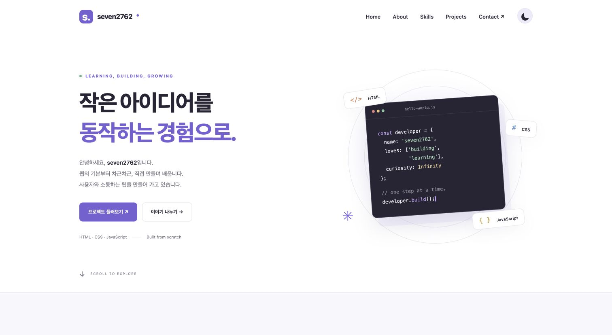
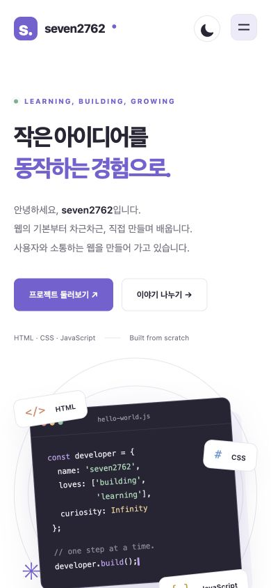
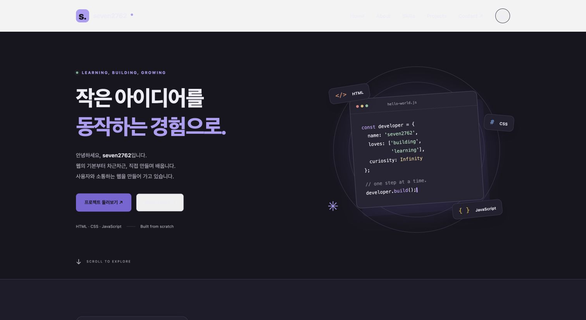

# seven2762 — Developer Portfolio

외부 라이브러리 없이 HTML, CSS, JavaScript로 만든 반응형 포트폴리오입니다. 핵심은 **사용자 이벤트 → 상태 변경 → DOM 업데이트** 흐름을 직접 구현하고 이해하는 것입니다.

- 저장소: https://github.com/seven2762/codyssey_b1_1
- 배포: https://seven2762.github.io/codyssey_b1_1/
- 기술: 시맨틱 HTML5, CSS3, ES6+ JavaScript, Fetch API, Intersection Observer, Web Storage, GitHub Pages
- 런타임 의존성 및 빌드 단계 없음

## 실행

### VS Code + Live Server

1. VS Code에서 프로젝트 폴더를 엽니다.
2. 확장 추천 목록의 **Live Server (ritwickdey.LiveServer)**를 설치합니다.
3. `index.html`을 우클릭하여 **Open with Live Server**를 선택합니다.
4. `http://127.0.0.1:5500`에서 확인합니다. 파일을 저장하면 자동으로 새로고침합니다.

`.vscode/extensions.json`과 `settings.json`에 확장 추천과 포트를 설정했습니다. VS Code와 확장 설치는 사용하는 개발 환경에서 진행합니다.

Python이 있다면 `python3 -m http.server 5500`으로도 실행할 수 있습니다. 이 방법은 자동 새로고침을 제공하지 않습니다. `file://` 대신 HTTP 서버로 실행하세요.

## 폴더 구조

```text
index.html                 시맨틱 페이지 구조
css/style.css              모바일 퍼스트 레이아웃과 테마
js/theme.js                저장된 테마 또는 시스템 테마 읽기
js/main.js                 상태, 이벤트, 렌더링, API, 폼 검증
images/profile.png         GitHub 프로필 이미지
images/favicon.svg         로컬 파비콘
screenshots/               데스크톱·모바일·다크 모드 캡처
.vscode/                   Live Server 설정과 확장 추천
.github/workflows/pages.yml GitHub Pages 자동 배포
```

기존 Python 파일은 웹사이트의 실행이나 배포에 사용하지 않습니다.

## 구현 기능과 기준

| 기능 | 동작 |
| --- | --- |
| 섹션 | Hero, About, Skills, Projects, Contact, Footer |
| 반응형 | 기본 모바일, 768px 이상 태블릿, 1024px 이상 데스크톱 |
| 메뉴 | 모바일에서 햄버거 토글, 메뉴 링크·바깥 클릭·Escape로 닫기 |
| 스크롤 | 앵커 부드러운 이동, 스크롤 60px 이상 헤더 배경 변경 |
| 맨 위 버튼 | 스크롤 300px 이상 표시, 클릭하면 맨 위로 이동 |
| 테마 | 라이트/다크 전환, `localStorage`의 `portfolio-theme`에 저장 |
| 애니메이션 | Intersection Observer `threshold: 0.2`, 최초 진입 시 표시 |
| 접근성 | label 연결, 의미 있는 alt, 포커스 표시, 본문 바로가기, aria 상태 |
| 모션 설정 | `prefers-reduced-motion`이면 부드러운 이동과 애니메이션 생략 |
| 폼 | 공백만 있는 값 거부, 이메일 검증, 필드별 에러, 성공 안내 |
| 프로젝트 | API 상태 UI, 최신 공개 저장소 최대 6개, fork 제외 필터 |

Contact는 **검증 데모**입니다. 제출 이벤트에서 `preventDefault()`를 호출하고 성공 메시지를 보여 줍니다. 실제 이메일 발송, 서버 저장 또는 외부 전송은 하지 않습니다.

## 이벤트 → 상태 → 렌더링

`js/main.js`의 `state` 객체가 UI 상태를 보관하고, `renderTheme`, `renderMenu`, `renderProjects`, `renderForm`이 상태를 화면에 반영합니다.

| 사용자 이벤트 | 변경하는 상태 | 화면 업데이트 |
| --- | --- | --- |
| 테마 버튼 click | `state.theme` | data-theme, 아이콘, aria-pressed |
| 메뉴 버튼 click | `state.menuOpen` | active 클래스, aria-expanded |
| API 요청/응답 | `state.projects.status`, `repos`, `error` | 로딩 / 카드 / 에러 / 빈 상태 |
| 필터 버튼 click | `state.projects.filter` | 선택 버튼과 프로젝트 목록 |
| 폼 input / submit | values, errors, touched, submitted | 필드 에러, aria-invalid, 성공 메시지 |

예를 들어 테마 버튼을 클릭하면 상태를 뒤집고 저장한 뒤 `renderTheme()`를 호출합니다. CSS는 `[data-theme="dark"]`의 변수로 전체 색상을 바꿉니다. React에서도 이벤트로 상태를 바꾸고 그 상태에 따라 화면을 렌더링한다는 같은 원리를 사용합니다.

## 학습 포인트

- **시맨틱 HTML**: `header`와 `nav`는 탐색, `main`은 본문, `section`은 제목이 있는 주제, `article`은 독립적인 기술·프로젝트 카드, `footer`는 저작권과 소셜 링크를 나타냅니다. 요소의 의미를 기준으로 구조를 설계하면 보조 기술과 검색 엔진이 콘텐츠를 이해하기 쉽습니다.
- **Flexbox와 Grid**: Flexbox는 네비게이션처럼 한 방향 정렬에 사용합니다. Grid는 카드처럼 행과 열을 함께 배치할 때 사용합니다. 프로젝트는 `repeat(auto-fit, minmax(min(280px, 100%), 1fr))`로 화면 너비에 따라 열 개수를 바꿉니다.
- **DOM과 이벤트**: `querySelector`로 하나의 요소를, `querySelectorAll`로 요소 목록을 선택합니다. `addEventListener`로 이벤트를 연결하고 `textContent`, `innerHTML`, `classList`로 결과를 반영합니다. HTML에 `onclick`이나 인라인 스타일을 넣지 않습니다.
- **ES6+**: 화살표 함수는 이벤트 핸들러와 렌더러를 정의합니다. 구조분해 할당은 저장소 객체에서 필요한 속성을 추출합니다. `filter`는 fork 제외, `map`은 객체를 카드 HTML로 변환, `forEach`는 이벤트 연결에 사용합니다. 템플릿 리터럴과 `join('')`으로 카드 목록을 생성합니다.
- **비동기**: `async/await`와 `fetch`로 데이터를 요청하고 `response.ok`를 확인합니다. `try/catch`는 HTTP 오류, 네트워크 오류, 15초 타임아웃을 처리합니다. 각 상태를 렌더링해 사용자에게 현재 진행 상황을 알립니다.

API에서 받은 설명과 이름은 `escapeHTML()`로 이스케이프합니다. 링크는 검증된 계정과 인코딩한 저장소 이름으로 구성하므로 API 문자열을 실행 가능한 HTML로 해석하지 않습니다.

## GitHub API

```text
https://api.github.com/users/seven2762/repos?sort=updated&per_page=100
```

- 인증 없이 공개 저장소를 조회합니다. 토큰을 브라우저에 넣지 않습니다.
- 한 번에 최신 저장소 최대 100개를 조회하고, 선택한 필터를 적용해 최대 6개를 표시합니다. 100개를 넘는 계정의 전체 저장소를 페이지네이션하지는 않습니다.
- 빈 배열 또는 필터 결과가 없으면 “표시할 프로젝트가 없습니다”를 표시합니다.
- 실패하면 “프로젝트를 불러올 수 없습니다”와 재시도 버튼을 표시합니다.
- 403/429 응답은 요청 한도 안내를 표시합니다. 인증 없는 GitHub API의 일반적인 요청 한도는 시간당 60회이며 네트워크의 다른 사용자와 공유할 수 있습니다.
- `sessionStorage`에 성공 응답을 5분간 캐시해 같은 탭의 반복 새로고침을 줄입니다. 재시도 버튼은 캐시를 건너뜁니다. 저장소 접근이 차단되어도 기본 기능은 동작합니다.
- 계정을 변경하려면 `GITHUB_USERNAME`, HTML의 프로필 링크·소개, 프로필 이미지를 함께 수정합니다.

## GitHub Pages 배포

저장소의 Pages 설정을 **GitHub Actions**로 구성했습니다. `main`에 push하면 `.github/workflows/pages.yml`이 HTML, CSS, JS, images만 배포합니다. 개발 환경, Python 파일, 스크린샷과 README는 사이트 산출물에 포함하지 않습니다.

GitHub의 Actions 탭에서 배포 상태를 확인할 수 있습니다. GitHub Pages의 정적 호스팅이므로 Contact 서버 전송 기능은 포함하지 않습니다.

## 검증

Chrome에서 다음을 확인했습니다.

- 데스크톱, 390px 모바일, 768px 태블릿의 가로 넘침 없음
- 모바일 메뉴 열기·닫기, 태블릿 메뉴 전환
- 다크 모드 전환 후 새로고침 시 유지
- 앵커 이동, 스크롤 헤더 변경, 맨 위 버튼
- 필수 입력 오류, 잘못된 이메일, 수정 후 성공 안내
- 실제 GitHub API의 저장소 카드 표시
- 별도 로컬 모의 응답으로 로딩, 빈 배열, 403 오류, 재시도 성공, fork 필터
- HTML 형태의 API 문자열이 실행되지 않고 텍스트로 표시됨
- JavaScript 구문 검사: `node --check js/main.js`, `node --check js/theme.js`

## 스크린샷

### 데스크톱



### 모바일



### 다크 모드


